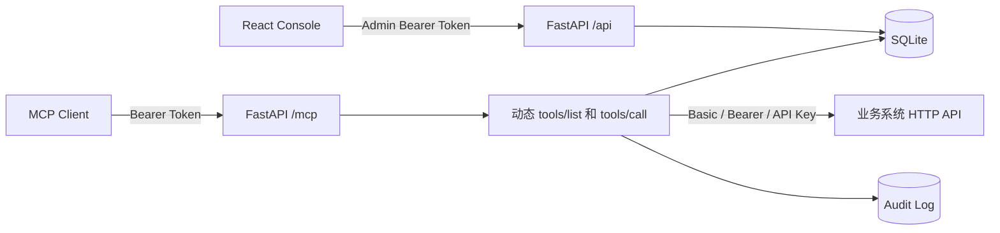

# 企业 MCP Gateway Demo

这是一个前后端分离、同仓库部署的企业 MCP Gateway 示例：

- `frontend/`：React + TypeScript + Vite + Ant Design 管理控制台。
- `backend/`：Python + FastAPI + SQLAlchemy + 官方 MCP Python SDK v2。
- 数据库默认使用 SQLite，工具配置修改后实时影响 MCP `tools/list` 和 `tools/call`，无需重启。
- MCP 入口使用 Streamable HTTP：`POST /mcp`。

## 已实现能力

- 业务系统新增、编辑、启停和删除。
- HTTP 工具新增、编辑、启停、删除和真实试调用。
- 工具名称、描述、HTTP 方法、端点、超时配置。
- 入参和出参 JSON Schema 配置与校验。
- 静态请求 Header 配置。
- 目标接口认证：Basic、Bearer、API Key，可指定 Header 名称。
- 认证密钥加密入库，管理 API 不回显明文或密文。
- 动态 MCP `tools/list` 和 `tools/call`。
- 管理端 Bearer Token 与 MCP 客户端 Bearer Token 分离。
- 调用审计只记录参数字段名，不记录参数值和业务响应。
- 端点 URL、重定向和基础 SSRF 防护。

## 调用链



## 本地启动

### 1. 启动后端

需要 Python 3.11 或更高版本。

```bash
cd backend
cp .env.example .env
python3 -m venv .venv
.venv/bin/pip install -e '.[dev]'
.venv/bin/uvicorn app.main:app --reload --host 0.0.0.0 --port 8000
```

后端地址：

- 健康检查：`http://127.0.0.1:8000/api/health`
- OpenAPI：`http://127.0.0.1:8000/docs`
- MCP Endpoint：`http://127.0.0.1:8000/mcp`

### 2. 启动前端

```bash
cd frontend
cp .env.example .env.local
npm install
npm run dev
```

浏览器打开 `http://127.0.0.1:5173`。开发模式下 Vite 会将 `/api` 和 `/mcp` 代理到 FastAPI。

默认演示凭证：

```text
管理控制台：dev-admin-key
MCP 客户端：dev-mcp-key
```

这些值只用于本地演示，部署前必须更换。

## Docker Compose

```bash
export ADMIN_API_KEY='replace-admin-key'
export MCP_API_KEY='replace-mcp-key'
export SECRET_ENCRYPTION_KEY='replace-with-a-long-random-secret'
docker compose up --build
```

控制台地址为 `http://127.0.0.1:5173`，MCP 地址为 `http://127.0.0.1:5173/mcp` 或 `http://127.0.0.1:8000/mcp`。

## MCP 客户端配置

客户端需要支持 Streamable HTTP，并携带独立的 MCP Bearer Token：

```json
{
  "type": "streamable-http",
  "url": "http://127.0.0.1:8000/mcp",
  "headers": {
    "Authorization": "Bearer dev-mcp-key"
  }
}
```

`tools/list` 每次从数据库查询已启用工具。`tools/call` 的执行顺序为：

1. 查找已启用工具及所属业务系统。
2. 使用 JSON Schema 校验 MCP 入参。
3. 检查目标 URL 和解析后的 IP。
4. 解密工具认证密钥并注入指定 Header。
5. GET、DELETE 参数作为 Query String，其余方法参数作为 JSON Body。
6. 调用目标业务系统。
7. 使用出参 Schema 校验 JSON 响应。
8. 返回 MCP 文本结果和可用的 `structuredContent`，同时写入审计日志。

## 认证配置说明

| 类型 | Header 示例 | 页面字段 |
|---|---|---|
| Basic | `Authorization: Basic xxx` | Header 名称、用户名、密码 |
| Bearer | `Authorization: Bearer xxx` | Header 名称、Token |
| API Key | `X-API-Key: xxx` | Header 名称、API Key |

页面编辑已有工具时，密钥输入框留空表示保留原密钥。切换认证类型时必须重新输入密钥。

## 验证命令

```bash
cd backend
.venv/bin/pytest -q

cd ../frontend
npm run typecheck
npm run build
```

## 生产化边界

当前项目是完整可运行的架构 Demo，不应直接用默认设置上线。生产环境还应完成：

- 用企业 OAuth/OIDC、用户身份和工具级 RBAC 替代单一 MCP API Key。
- 用 Vault、KMS 等密钥管理系统替代应用级加密密钥。
- 将 SQLite 替换为 PostgreSQL 或 MySQL，并使用迁移工具管理表结构。
- 使用严格的目标域名白名单、固定 DNS/出口代理和网络层 egress policy，加强 SSRF 与 DNS rebinding 防护。
- 将管理面与 MCP 数据面部署到不同域名或网络区域。
- 增加租户、审批、配置版本、发布回滚、限流、熔断、重试和 OpenTelemetry。
- HTTPS 终止后正确配置 `MCP_ALLOWED_HOSTS`、`MCP_ALLOWED_ORIGINS` 和反向代理可信范围。

